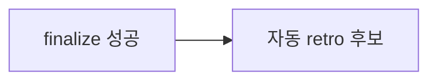

# 004 세션 근거 retro

Epic: [095](../../index.md)

## Intent
세션에서 드러난 실패·반복 지적·비효율 탐색·검사 누락을 기존 검사와 규칙 개선으로 잇는 절차가 없어 같은 문제가 다음 작업에서 반복됨.
transcript 후보 탐색·정규화 CLI와 후보 제안 전용 `/bouncer-retro` 스킬을 추가하고, finalize 성공 뒤 자동 실행하되 finalize 결과는 바꾸지 않게 함.

## Flow

## Contract
- 인터페이스:
  - `bouncer retro sources [--repo <dir>] [--limit <1..200>] [--claude-root <dir>] [--codex-root <dir>] [--cursor-root <dir>]` → `{ ok: true, project_root, sources: Source[], skipped: Skipped[] }`
  - `bouncer retro read --path <file> [--max-chars <n>]` → `{ ok: true, host, format, messages: { role, text }[], truncated, skipped_lines }`. 지원하지 않는 형식이면 `{ ok: false, reason }`이고 종료 코드 1이다.
  - `/bouncer-retro` 스킬은 ACQ 게이트가 없다(`rules/acq-gates.json` `"bouncer-retro": []`).
  - `/bouncer-finalize` step 5 Handoff 뒤에 retro를 자동 실행한다.
- 데이터·상태:
  - 두 CLI는 읽기 전용이다. 파일·설정·pointer를 쓰지 않는다.
  - retro 스킬도 파일을 쓰지 않고 결과를 채팅에만 출력한다.
  - `Source = { host: 'claude-code' | 'codex' | 'cursor', path, format: 'jsonl' | 'sqlite', mtime, size }`
  - `Skipped = { host, path, reason }`
- 수용 기준: epic Success criteria 6·7·8과 BP 범위의 10이 참이다.
- 검증 명령: `npm run ci`
- 실패 모드·엣지 케이스:
  - host 루트가 없으면 `root-missing`, 권한이 없으면 `permission-denied`로 skipped에 남긴다.
  - Codex 세션 첫 줄을 해석할 수 없으면 `unparseable-session-meta`로 남긴다.
  - Cursor DB에 알려진 key가 없으면 `retro read`가 `unsupported-schema`를 돌려준다.
  - 근거가 하나도 없으면 retro는 "후보 없음"과 이유를 출력한다.
  - retro가 실패해도 finalize는 이미 `closed`이고 성공 출력이 유지된다.
  - finalize가 `ok: false`로 끝나면 retro를 실행하지 않는다.
  - PR 단계가 거절·생략돼도 finalize가 성공했으면 retro를 실행한다.

## Out of scope
- retro 결과 파일 저장, Distill·promotion 부활, 다음 세션 자동 주입
- 후보의 자동 적용·규칙 변경, 의무 retro 게이트
- cursor-agent CLI 저장소(`~/.cursor/chats`)의 내용 해석
- WSL에서 Windows 쪽 Cursor 저장소 자동 탐색(`--cursor-root`로 지정)
- 네트워크 전송·외부 서비스 업로드

## One-commit justification
- CLI 두 개, 스킬, finalize 연결은 retro라는 한 기능의 층이다. 각 층을 task 커밋으로 순서대로 쌓고 한 PR로 리뷰한다.

## Documents
* [Tasks 001](tasks/001/tasks.md) - `retro sources` transcript 후보 탐색
* [Tasks 002](tasks/002/tasks.md) - `retro read` transcript 정규화
* [Tasks 003](tasks/003/tasks.md) - `/bouncer-retro` 스킬과 등록
* [Tasks 004](tasks/004/tasks.md) - finalize 성공 뒤 자동 retro
* [Verification](tasks/001/verification.md) - 검증 명령과 증적
* [Review](review.md) - 리뷰 발견사항
* [Context review](context-review.md) - 계획 문서 정합성 판정
