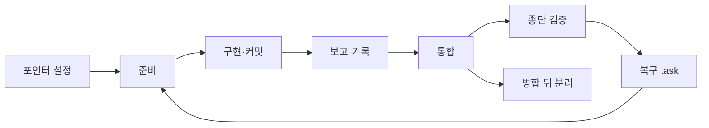

# 워크플로 상태 전이 사전 거절

## Intent
- 문제: ontology CLI 실행(blueprint 111/002)에서 coordinator가 잘못된 복구 task 값으로 세 번 재배정했다. 커밋 전에 결과를 기록했고, 재준비 과정에서 미커밋 수정을 잃었다. 병합 뒤에는 포인터와 ledger가 남아 메인 커밋이 막혔다. 원인은 각 전이를 CLI가 받아들이고 순서를 문서 지시에만 맡긴 데 있다.
- 목표: 복구 task 생성, report·record, revoke·prepare, 포인터 설정, 병합 뒤 실행 분리에서 잘못된 전이를 CLI가 mutation 전에 거절하고 `next`로 올바른 행동을 안내한다. 스킬과 agent 문서도 같은 계약을 따른다.

## Success criteria
1. `scoped_terminal` blueprint에서 `bouncer coordinate repair`는 task 전용 `--verify`가 없거나, 단일 argv가 아니거나, 종단 명령과 같으면 ledger·문서를 바꾸지 않고 거절한다. legacy blueprint에서 `--verify`를 주지 않으면 repair verify 결정은 지금과 같고, `--verify`를 주면 단일 argv 검사만 적용한다.
2. repair와 `coordinate revise`의 경로는 integration HEAD에 추적된 파일(또는 추적 파일이 있는 디렉터리)이어야 하고, 새 파일은 `--new-path`로만 허용한다. 그 밖의 경로는 mutation 전에 거절된다.
3. 재검증 실패 증거의 `paths`는 복구 task의 현재 scope revision 경로다.
4. `coordinate report --outcome accepted`와 `coordinate record`는 worker 커밋이 없거나, `commit_sha` stamp가 HEAD와 다르거나, scope 안 파일이 dirty이면 ledger를 바꾸지 않고 거절하며 `next`를 낸다.
5. `worker-evidence-sha-mismatch`의 `cause`·`next`는 실제 원인(stamp와 기록 SHA 불일치)과 복구 경로를 말한다.
6. revoke 뒤 `prepare`는 dirty하거나 미통합 커밋이 있는 worker를 지우기 전에 patch와 salvage ref로 보존하고 출력에 그 위치를 싣는다. 보존에 실패하면 아무것도 지우지 않는다.
7. base checkout에서 `bouncer current --set`이 새 key를 더해 선택을 ambiguous로 만들면 아무것도 바꾸지 않고 `CURRENT_WOULD_BE_AMBIGUOUS`로 거절한다. `--replace`와 `--keep-others`는 명시적으로만 동작한다. `CURRENT_AMBIGUOUS` 출력에는 `next`가 있다.
8. 사용자가 승인한 `bouncer run detach --blueprint <dir> --yes`는 ledger와 worktree를 보존한 채 `detached`를 기록하고 해당 key 하나만 지운다. 그 뒤 메인 커밋은 `main-worktree-source-write`로 막히지 않고, detached ledger에 대한 coordinator mutation은 거절된다. detach는 검증 성공이나 finalize로 기록되지 않는다.
9. 각 문제는 실제 상태 전이를 거치는 회귀 테스트로 재현되고, 정상 복구·사용자 승인 경계·ledger 보존 테스트가 계속 통과한다.
10. 종단 `npm run ci`가 exit 0으로 끝난다. 여기에는 `test/commit-hook.test.js` 테스트 이름 형식 수정이 포함된다.
11. 새 거절 코드와 새 플래그가 각각 `rules/cli.md`에 문자열로 나타나고(`rg -F` 확인), 새 플래그는 해당 CLI usage 테스트(`test/cli-help.test.js`·`test/cli-current.test.js`·`test/cli-coordinate.test.js`)에서 단언되며, `npm run lint:docs`가 통과한다.

## Out of scope
- ontology 검색 동작 변경.
- `CT-001` 테스트 보강(`test/cli-ontology.test.js`).
- blueprint 111의 ledger·worktree·문서 수정이나 재사용.
- Git 병합을 finalize나 검증 성공으로 간주하는 동작.
- 안전 검사 우회, 포인터 일괄 삭제.
- detach를 되돌리는 re-attach 명령.
- drive metrics의 예외 집계 변경.

## Blueprints
* [001 워크플로 상태 전이 가드](blueprints/001-transition-guards/index.md) - repair·report·record·prepare·current·run detach의 사전 거절 가드와 스킬 계약 (`scripts/src/lib/`, `rules/`, `skills/`, `agents/`)
