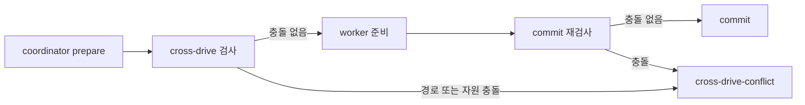

# Explain

## Background

여러 coordinator drive가 동시에 실행될 때 기존에는 각 drive의 원장과 작업 범위가
독립적으로 처리됐다. 그래서 서로 같은 파일이나 `exclusive_resources`를 건드리는
두 작업이 prepare를 통과하거나, prepare 이후 경합이 생겼을 때 commit까지 진행할
여지가 있었다.

이 blueprint는 다른 활성 integration 원장의 시작된 작업과 현재 작업의 경로·자원을
비교한다. 겹치지 않는 drive는 계속 진행시키되, 겹치면 상대 blueprint와 task 및
충돌한 경로·자원을 포함한 거절 결과를 반환한다. 원장을 읽지 못하면 fail-closed로
처리한다.

## Code

- `scripts/src/lib/cross-drive.ts`는 활성 원장을 읽고 path ancestry 및
  `exclusive_resources` 충돌을 계산한다.
- `execution-dag.ts`와 `coordinator-prepare.ts`는 prepare 전에 이 판정을 적용한다.
- `commit-guard.ts`, `commit.ts`, `commit-hook.ts`는 staged 경로와 task 자원을 다시
  비교해 prepare 이후 발생한 경합도 commit 시 차단한다.
- `test/cross-drive.test.js`와 coordinator·commit 관련 테스트는 충돌, 비충돌,
  unreadable ledger, legacy scope를 검증한다.
- `test/tiers.json`에는 `cross-drive.test.js`를 integration tier로 등록했다.

prepare와 commit 양쪽에서 검사하므로, 동시 prepare 뒤에 생긴 충돌도 commit 단계에서
놓치지 않는다.

## Quiz

종단 CI 검증이 현재 `verifying` 상태이므로 comprehension quiz는 아직 기록하지
않는다. 기록된 CI 실패가 후속 재실행에서 재현되지 않아, 안정적인 실패 로그를 확보한
뒤 terminal 검증을 재개해야 한다.

## Tasks

| Task | 결과 | 핵심 변경 |
| --- | --- | --- |
| 001 | integrated | drive 간 충돌 판정 모듈과 prepare 연결 |
| 002 | integrated | commit guard·hook 재검사 |
| 003 | integrated | CLI·workflow·changelog 문서화 |
| 004 | integrated | direct-run·계획 작성 규칙 보정 |
| 006 | integrated | `cross-drive.test.js` integration tier 등록 |

`TASKS-005`는 terminal `npm run ci` 검증 노드이며, 원인 불명의 비재현 실패 때문에
`verifying` 상태로 보존되어 있다.
