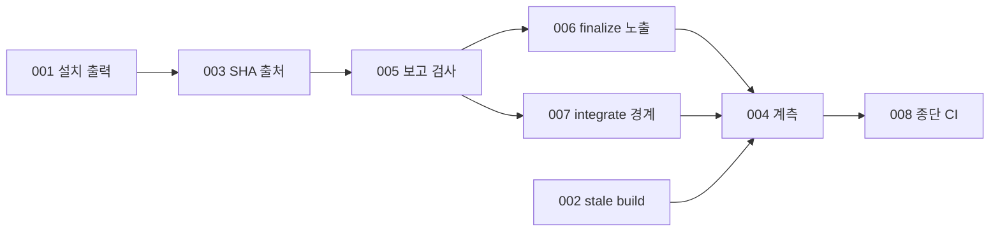

# 001 드라이브 기반 안정화와 실행 출처·계측

Epic: [098](../../../drive-plan-cost-control/index.md)

## Intent
- 문제: 의존성 설치 출력과 오래된 빌드가 coordinator 회차를 소모하고, worker 보고의 revision·열린 선택·SHA·직접 수정의 출처가 원장과 이력에 남지 않으며, 재기동 비용을 잴 계측이 없다.
- 완료 조건: CLI가 출력 오염과 stale build를 원인에서 막고 보고·SHA·integrate 출처를 검사·기록하며, 세션과 계획 리뷰 호출의 진행·토큰을 기록한다.

## Contract
- 인터페이스:
  - coordinator 명령의 stdout은 결과 JSON 한 개다. 의존성 설치 출력은 stderr로 간다.
  - `scripts/bouncer`, `scripts/bouncer-root`는 `scripts/src`가 있고 `scripts/lib/.build-stamp`가 소스 해시와 다르면 `bouncer: stale-build: …`와 exit 1로 끝난다.
  - full fan-in integration 커밋은 `Bouncer-Worker-Commit: <40hex>` trailer를 갖는다. finalize digest `tasks[].commit.worker_sha`가 그 값을 낸다.
  - `coordinate report`(full)는 보고 파일 기준 `report-revision-missing`, `report-revision-conflict`, `report-section-missing`을 내고, `ReportDecision`에 `open_choices`·`known_weaknesses`를 저장한다.
  - finalize digest `tasks[].worker_notes`와 `pr.sections.review_points`의 `구현 선택(…)`·`알려진 약점(…)` 항목.
  - `coordinate integrate`(full commit wave)는 `integration-source-mutated`를 내고, 성공 결과의 선택 키 `warnings[]`로 보고 경로 불일치를 알린다.
  - `bouncer metrics start|end|summary`, 설정 `metrics.pricing`, checkpoint `sessions[]`.
- 데이터·상태:
  - 원장 소유: `ReportDecision`의 새 배열 두 개. 원장 위치와 그 밖의 shape는 그대로다.
  - 계측 소유: main worktree의 `.bouncer/runtime/drive-metrics.json`(`version: 1`). 원장이 아니다.
  - git 이력 소유: worker→integration 커밋 대응은 trailer가 정본이다. 원장 `task.sha`는 worker SHA로 남는다.
  - 보고 파일 위치는 `reportPathFor`의 `<worker>/.bouncer/runtime/reports/<task>-<attempt>.md` 하나다.
- 수용 기준: epic Success criteria 1·3·4(trailer·`worker_sha`)·5·6(거절·원장 저장·digest·PR)·8과 15의 단어 수·TOML 일치는 task 테스트와 `npm run ci`가 판정한다. 문서 조항(2의 재실행 금지, 4의 SHA 출처 표기, 6의 explain 지침, 7의 카드 항목, 15의 CHANGELOG)은 BP 최종 리뷰가 해당 파일의 문구 존재로 판정한다.
- 검증 명령: `npm run ci`
- 실패 모드·엣지 케이스:
  - npm 설치 실패는 기존 reason을 유지한다.
  - JSON 앞에 잡음이 있으면 파서를 느슨하게 하지 않고 원인에서 막는다.
  - stamp가 없으면 stale로 본다. `scripts/src`가 없는 배포본과 tmp fixture는 검사를 생략한다.
  - cherry-pick 뒤 amend가 실패하면 `cherry-pick-failed`로 멈춘다. verified fanin 재개는 trailer를 다시 붙이지 않는다.
  - light 모드는 보고 파일 검사·dirty 검사·trailer를 적용하지 않는다. verification 노드 integrate에도 dirty 검사는 없다.
  - Cursor print에서 implementer가 보고 파일을 쓰지 않으면 `report-revision-missing`이 나고 coordinator가 재dispatch한다.
  - 보고가 없거나 제목이 없으면 경로 대조는 실패가 아니라 `report-changed-files-unavailable` 경고다.
  - 토큰·가격이 없으면 0으로 세지 않고 `null`과 사유를 기록한다. 깨진 metrics 파일은 덮어쓰지 않는다.

## Out of scope
- 다중 wave 세션, DAG 모양 분석, root 직접 실행, 측정 fixture(BP 002).
- plan context review 관점·dispatch 기준·Touch 경로 gate 변경(BP 003).
- `prepareDependencies` 기본 stdio와 finalize 설치 경로, 벤치마크 하네스, 096 cycle·delta 계약.

## One-commit justification
- 일곱 task는 coordinator 출력·보고·integrate·finalize의 출처 계약을 함께 바꾼다. 하나의 PR에서 리뷰해야 보고 형식(TASKS-005)과 그 소비자(TASKS-006, TASKS-007), SHA trailer와 digest(TASKS-003)가 어긋나지 않는다. 각 task는 독립 커밋이고 BP 리뷰는 한 번이다.

## Task DAG

## Documents
* [Tasks 001](tasks/001/tasks.md) - coordinator 설치 출력 분리와 advance 재실행 금지
* [Tasks 002](tasks/002/tasks.md) - 빌드 stamp와 launcher stale-build 검사
* [Tasks 003](tasks/003/tasks.md) - worker 커밋 trailer와 SHA 출처 표기
* [Tasks 004](tasks/004/tasks.md) - 세션·계획 리뷰 계측과 CHANGELOG
* [Tasks 005](tasks/005/tasks.md) - 보고 파일 revision 검사와 열린 선택 기록
* [Tasks 006](tasks/006/tasks.md) - finalize digest·PR 리뷰 포인트 노출
* [Tasks 007](tasks/007/tasks.md) - integrate 직접 수정 거절과 Contract 대조 카드
* [Tasks 008](tasks/008/tasks.md) - 종단 `npm run ci`
* [Review](review.md) - 리뷰 발견사항
* [Context review](context-review.md) - 계획 문서 정합성 판정
