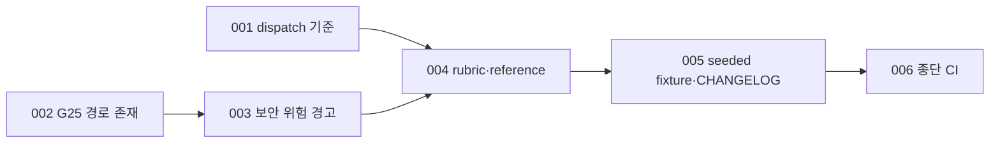

# 003 plan context review 관점 통합과 기계 검사 이관

Epic: [098](../../../drive-plan-cost-control/index.md)

## Intent
plan context review는 문장 품질과 경로 존재처럼 문서 정합성과 무관하거나 기계로 확인할 수 있는 판단까지 reviewer에게 맡기고, commit task가 2개만 되어도 local·global 다중 호출로 갈라진다.
필수 판단을 문서 정합성·범위와 검증 가능성으로 줄여 작은 계획은 한 번에 리뷰하고, 경로 존재와 보안 위험 표시 누락은 plan gate가 판정하며, Contract 저장 위치·상태 소유권 대조를 rubric에 추가한다.

## Contract
- 인터페이스:
  - `bouncer review-dispatch plan`: commit task 3개 이하는 `strategy: single`·`perspectives: ['combined']`, 4개 이상은 기존 `clustered`(cluster별 `local` + `global`). export 상수 `PLAN_SMALL_MAX_TASKS`는 3이다.
  - `bouncer validate --gate plan` 새 실패 코드 `G25`: `draft`·`ready` commit task의 Touch 표에서 `Modify`·`Delete` 행 경로, `Rename` 행의 첫(이전) 경로가 저장소 루트에 없고 전이 `depends_on` 선행 task의 `Create` 경로·`Rename` 새 경로도 아니면 실패한다.
  - `bouncer validate --gate plan` 새 경고 코드 `review-risk-missing`: `review_risk`가 없거나 `[]`인 commit task의 Touch 경로 segment·basename이 export 상수 `SECURITY_PATH_TOKENS`(`auth`, `login`, `session`, `token`, `credential`, `secret`, `password`, `permission`, `acl`, `oauth`, `jwt`)와 일치하면 task당 경고 하나를 낸다. 실패가 아니며 `ok`를 바꾸지 않는다.
  - context reviewer rubric: 필수 판단은 `cross_document`(문서 정합성·범위)와 `success_criteria`(검증 가능성) 두 가지다. 호출별 분담은 다음과 같다.
    - `combined`: 두 판단 전부.
    - `local`: cluster 안 task의 Interface·Touch·Checklist 일관성, Checklist 수정 경로와 `affected_paths`, task `review_risk` 표시, red assertion.
    - `global`: epic→blueprint→task와 cluster 사이 정합성, Contract 저장 위치·상태 소유권과 task 브리프 대조, 공유 경로·DAG, epic 성공 기준 커버리지.
    - 경로 존재는 G25, 문장 품질은 작성 단계 stop-slop(advisory)이 맡고 reviewer 판단 밖이다.
- 데이터·상태:
  - 관점 enum `CONTEXT_REVIEW_PERSPECTIVE`(G18)는 legacy `scope`·`korean_quality`를 계속 받는다. 과거 round 기록은 그대로 통과하고, dispatch·역할 문서·scaffold 템플릿만 새 finding category를 `combined | local | global`로 안내한다.
  - Contract 저장 위치·상태 소유권 대조는 `cross_document` 판단에 속한다. Contract가 상태를 둔 문서·필드와 task 브리프 Interface·Touch·Checklist가 가리키는 저장 위치가 다르면 finding이다.
  - 계측 소유는 BP 001 그대로다. plan context review 호출은 `bouncer metrics start --kind context-review`로 기록된다.
- 수용 기준: epic Success criteria 13·14는 task 테스트와 `npm run ci`가 판정한다. 역할 문서·reference의 rubric 문구, seeded fixture·측정 절차(`benchmarks/plan-review/`), 15의 CHANGELOG는 BP 최종 리뷰가 파일의 문구 존재로 판정한다. 15의 TOML 일치와 단어 수는 `npm run ci`가 판정한다.
- 검증 명령: `npm run ci`
- 실패 모드·엣지 케이스:
  - G19가 실패한 plan에서는 선행 closure를 만들 수 없으므로 G25를 계산하지 않는다.
  - `in_progress` 이후 상태의 task는 이미 Delete·Rename을 실행했을 수 있으므로 G25 대상이 아니다. verification 노드와 `scale: light` blueprint도 대상이 아니다.
  - 선행 task가 `Create`하는 경로를 후행 task가 `Modify`하면 통과한다. 선행 관계가 없는 task의 `Create`는 근거가 되지 않는다.
  - Touch 표가 없거나 `변경` 칸이 네 값 밖이면 G25는 그 행을 건너뛴다. 표 형식은 G10이 다룬다.
  - `review-risk-missing`은 `review_risk`가 하나라도 있으면 내지 않는다. 일치 토큰이 경로 일부 문자열에만 있고 segment·basename 단위가 아니면(예: `tokenizer.ts`) 내지 않는다.
  - `review-risk-missing`은 G10이 실패한 task(Touch 미작성)와 `.bouncer/`로 시작하는 계획 문서 경로를 검사하지 않는다. plan gate와 plan draft 모두 같은 경고를 내고, light task도 대상이다.
  - G25는 `repoRoot`가 없는 plan draft 검사에서 판정하지 않는다. 표가 아닌 bullet Touch(light 템플릿·repair task)는 G25 대상이 아니다.
  - commit task가 정확히 3개면 `single`, 4개면 `clustered`다. light blueprint는 기존대로 `skip`이다.
  - legacy 관점 이름이 적힌 기존 `context-review.md`는 G18을 통과한다.

## Out of scope
- reviewer 모델·수, 096 cycle·restart 1회·delta 계약 변경.
- `review_risk` enum 변경과 보안 경로 패턴의 설정화.
- legacy 관점 이름을 새 round에서 거절하는 검사.
- 실제 측정 실행. merge 뒤 사용자가 seeded fixture로 실행해 `benchmarks/drive-serial-4/results.md` BP 003 표에 기록한다.
- light 모드와 execute diff 리뷰(`review.md`) 관점.

## One-commit justification
- dispatch 기준(TASKS-001), 경로 존재 gate(TASKS-002), 보안 위험 경고(TASKS-003)는 reviewer rubric(TASKS-004)이 판단 범위에서 빼거나 입력으로 삼는 계약이고, seeded fixture(TASKS-005)는 그 분담이 결함을 놓치지 않는지 재는 도구다. rubric이 넘긴 판단을 gate가 실제로 받는지 한 PR에서 함께 리뷰한다.

## Task DAG

## W 추적
| 작업 | 대응 task |
| --- | --- |
| W06 보안 위험 표시 | 003, 004, 005 |
| W09 저장 위치·상태 소유권 대조 | 004, 005 |
| W13 관점 통합과 호출 축소 | 001, 002, 004, 005 |

## Documents
* [Tasks 001](tasks/001/tasks.md) - plan dispatch single 기준 3
* [Tasks 002](tasks/002/tasks.md) - G25 Touch 경로 존재
* [Tasks 003](tasks/003/tasks.md) - `review-risk-missing` 경고
* [Tasks 004](tasks/004/tasks.md) - reviewer rubric·reference 정리
* [Tasks 005](tasks/005/tasks.md) - seeded fixture와 CHANGELOG
* [Tasks 006](tasks/006/tasks.md) - 종단 CI 검증
* [Review](review.md) - 리뷰 발견사항
* [Context review](context-review.md) - 계획 문서 정합성 판정
