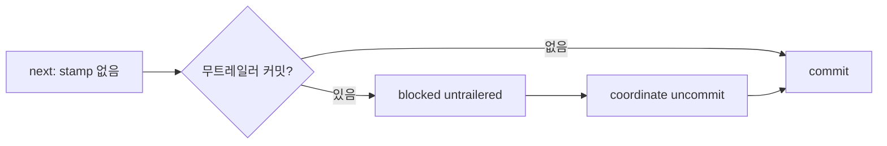

# 무트레일러 worker 커밋 차단과 uncommit 복구

Epic: [drive-execution](../../index.md) · Tasks: [001](tasks/001/tasks.md) · [002](tasks/002/tasks.md) · [003](tasks/003/tasks.md) · [004](tasks/004/tasks.md)

## Intent
worker가 트레일러 없이 직접 커밋하면 `coordinate next`가 `commit`을 반복하던 동작을 `blocked`로 바꾸고, 새 `coordinate uncommit`으로 그 커밋을 되돌려 `bouncer commit`이 트레일러 커밋을 다시 만들게 한다. 정상 경로의 `commit`·`report` 판정과 report·record 거절 규칙은 그대로 둔다.

## Contract
- 인터페이스:
  - `coordinate next --task <ddd>`: stamp(`commit_sha`)가 비어 있고 `integrationHead..HEAD`에 `Bouncer-Task` 트레일러가 없는 커밋이 하나라도 있으면, scope dirty 여부와 무관하게 `{ action: 'blocked', reason: 'worker-commit-untrailered', cause, next }`를 낸다. `next` 문구는 `coordinate uncommit`과 그 뒤 `coordinate advance`를 안내한다.
  - 새 fenced 명령 `bouncer coordinate uncommit --blueprint <dir> --task <ddd> --ledger-path 
 --ledger-hash <h>`를 추가한다. 할당된 worker cwd(light는 integration cwd)에서만 실행한다.
  - `coordinator-worker.ts`의 읽기 전용 판별 함수가 무트레일러 커밋 목록(오래된 순 SHA)을 돌려준다. next와 uncommit이 이 함수 하나를 함께 쓴다.
  - "무트레일러 커밋"은 `integrationHead..HEAD`의 first-parent 경로에 있는 커밋 가운데, 이 task의 기대 ref(`buildStableProvenance`가 task frontmatter `epic_id`·`blueprint_id`·`id`로 만드는 값)와 같은 `Bouncer-Task:` 줄이 없는 커밋이다. task 식별자가 없거나 형식이 틀려 ref를 만들 수 없으면 값과 무관하게 `Bouncer-Task:` 줄이 있는지만 본다. merge 커밋도 같은 규칙을 따른다.
- 데이터·상태:
  - uncommit은 stamp가 빈 task에서만 가장 오래된 무트레일러 커밋의 first parent로 `git reset --soft`한다. 변경은 index와 작업 트리에 남는다.
  - 원장 task와 blueprint `decisions`에 `{ task, kind: 'uncommit', attempt, fromHead, toHead, commits }`를 추가한다. `drive-metrics`는 `uncommit`을 예외 판단 kind로 센다(`isException(decision) === true`).
- 수용 기준: epic Success criteria 8·13·16. 테스트가 고정하는 실패 모드는 다음과 같다. TASKS-001은 `integrationHead` 부재와 다른 task ref 트레일러를, TASKS-002는 stamp 거절·누적 커밋·`uncommit-not-needed`·`illegal-transition`·`writeLedger` throw 되돌림을 고정한다. lock 상실 되돌림, `uncommit-rollback-failed`, scope 밖 staged 경로, 판별 중 git 실패, fence·할당 거절은 기존 경로(`commitWrite`, `bouncer commit` scope 검사, `git`, `guardWorkerDispatch`)를 재사용하므로 리뷰로 확인한다.
- 검증 명령: commit task마다 task 전용 `node --test ...`를 실행하고, 종단 verification task는 `npm run ci`를 실행한다.
- 실패 모드·엣지 케이스:
  - `integrationHead`가 원장에 없으면 판별 함수는 빈 목록을 돌려준다. next는 기존 `commit`을 내고 uncommit은 `uncommit-not-needed`로 거절한다.
  - 무트레일러 커밋이 없으면 uncommit은 `uncommit-not-needed`로 거절하고 Git과 원장을 바꾸지 않는다.
  - task가 `prepared`가 아니거나, `dispatch.status`가 `active`가 아니거나, `tasks.md`에 stamp(`commit_sha`)가 이미 있으면 `illegal-transition`이다. stamp된 커밋은 reset하지 않는다.
  - fence가 낡았거나 worker 할당이 다르면 기존 거절(fence 계열, `unassigned-worker-worktree`)을 따른다.
  - reset 뒤 원장 쓰기가 lock 상실(`ledger-lock-lost`)을 돌려주거나 throw하면 `git reset --soft <fromHead>`로 HEAD를 되돌린 뒤 그 결과를 반환하거나 같은 오류를 다시 throw한다. 되돌림 reset까지 실패하면 `uncommit-rollback-failed`(`fromHead`·`toHead` 포함)를 반환한다.
  - 무트레일러 커밋 위에 트레일러 커밋이 쌓여 있어도 가장 오래된 무트레일러 커밋의 부모로 reset한다. 위의 변경은 index에 보존되고 다음 `bouncer commit` 하나에 모인다.
  - reset으로 staged가 된 경로 가운데 task scope 밖의 경로는 다음 `bouncer commit`의 기존 scope 검사가 거절한다(`out-of-scope`). uncommit은 scope를 넓히지 않는다.
  - 판별 중 git 호출이 실패하면 next의 다른 git 호출과 똑같이 예외로 끝난다(`coordinator-git.ts`의 `git` 동작 유지).
  - stamp가 이미 있는 경로(`report`, `worker-commit-stamp-mismatch`, `commit-evidence-mismatch`)의 판정은 바뀌지 않는다.

## Out of scope
- `coordinate report --outcome accepted`·`record`의 `workerCommitEvidence` 거절 규칙 변경. 기존 fixture가 트레일러 없는 커밋으로 worker 커밋을 흉내 내므로 이번에는 next만 바꾼다.
- 같은 `commit`이 연속으로 `committed:false`일 때 멈추는 반복 방어.
- `advance`가 uncommit을 자동 실행하는 deterministic action.
- implementer 문서의 "Do not commit" 계약 변경, RETRO 2-2·2-3(BP C).
- `CHANGELOG.md`·버전 파일 변경.

## One-commit justification
- 판별 함수, 그것을 쓰는 next 분기와 uncommit 명령, 이를 설명하는 coordinator 문서는 하나의 복구 경로를 이룬다. 따로 병합하면 `next` 안내가 존재하지 않는 명령을 가리키므로 한 PR로 낸다.
