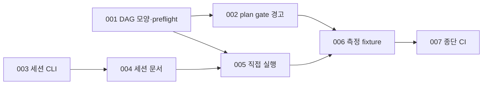

# 002 직렬 드라이브 세션 연속과 DAG 모양 판단

Epic: [098](../../index.md)

## Intent
직렬 체인에서 coordinator가 wave마다 재기동되고, 짧은 직렬 체인에도 coordinator 계층이 붙으며, 계획 단계에서는 DAG 모양을 알려 주지 않는다.
CLI가 DAG 모양과 세션 경계를 결정적으로 계산해 직렬·무예외 wave를 한 세션에서 잇고, 짧은 직렬 체인은 root 직접 실행을 고를 수 있게 하며, 효과를 잴 fixture와 기록 문서를 남긴다.

## Contract
- 인터페이스:
  - 공유 모듈 `scripts/src/lib/dag-shape.ts`: `analyzeDriveShape(tasks, { maxParallel })`이 `readyWave`를 반복 시뮬레이션해 `{ drive_shape, max_wave_width, commit_tasks, review_risk, parallel_safe_tasks }`를 내고, `pathOverlapRatio(a, b)`가 경로 중첩률을 낸다.
  - `bouncer run preflight` 성공 payload에 `shape`(위 객체)와 `direct_eligible`(boolean)이 추가된다.
  - `bouncer validate --gate plan` `warnings[]`에 `dag-serial-overlap`, `dag-disjoint-edge`가 추가된다. 실패가 아니며 `ok`를 바꾸지 않는다.
  - 설정 `coordinator.waves_per_session`(`auto` | 정수 1–8), `coordinator.direct_max_commit_tasks`(정수 0 이상, 0이면 끔).
  - `bouncer coordinate session-open --blueprint <dir> --ledger-path 
 --ledger-hash <h>`: 원장에 `session` 결정을 덧붙인다.
  - `coordinate next` 새 action `yield`(`reason`: `session-wave-cap` | `wave-exception` | `parallel-wave`, argv 없음). `coordinate advance` 새 정지 사유 `yield`.
  - `bouncer metrics start --kind root-direct-session`.
  - `/bouncer-run` 시작 ACQ의 조건부 선택지 "직접 실행(coordinator 없음)"과 `skills/bouncer-run/references/direct-run.md`.
- 데이터·상태:
  - 원장 소유: 새 결정 `{ kind: 'session', opened_at, integration_head, waves_cap }`. 기존 결정 shape는 그대로다.
  - wave 수는 마지막 `session` 결정 뒤의 `fanin` 결정 수다. `session` 결정이 없는 원장은 원장 시작부터 센다.
  - 예외 집합 `EXCEPTION_KINDS`는 `drive-metrics.ts`에서 export해 `coordinate-next`와 공유한다. accepted가 아닌 `report`도 예외다.
  - 계측 소유는 BP 001 그대로 `.bouncer/runtime/drive-metrics.json`이다.
- 수용 기준: epic Success criteria 9·10·11은 task 테스트와 `npm run ci`가 판정한다. 12의 fixture·기록 문서, 11·9의 문서 조항(direct-run.md·coordinator 역할 문서), 15의 CHANGELOG는 BP 최종 리뷰가 해당 파일의 문구 존재로 판정한다. 15의 TOML 일치와 단어 수는 `npm run ci`가 판정한다.
- 검증 명령: `npm run ci`
- 실패 모드·엣지 케이스:
  - `waves_per_session`이 잘못되면 `coordinate prepare`가 기존 `coordinator-config-invalid`로 거절하고, 읽기 전용 `next`는 상한 1로 접는다.
  - verification 노드만 남은 wave는 상한·예외와 관계없이 yield하지 않는다.
  - 세션의 첫 wave는 항상 prepare한다. yield는 그 세션에서 wave가 하나 이상 통합된 뒤에만 나온다.
  - 미해결 blocker·반복 gate 실패는 기존 `blocked` 경로를 따른다. yield로 세션을 바꿔 우회하지 않는다.
  - DAG 시뮬레이션이 진행하지 못하면 `drive_shape: 'unknown'`이고 `direct_eligible`은 false다. 열린 commit task가 없으면 `drive_shape: null`이다.
  - `max_parallel` 설정이 잘못되면 preflight는 기존대로 1로 접어 계산한다.
  - G19가 실패한 plan에서는 DAG 모양 경고를 계산하지 않는다. verification 노드는 경고 계산에서 빠진다.
  - direct 모드에서 accepted가 아닌 판단이나 예외 정지가 나오면 root는 그 판단을 원장에 기록하지 않고 coordinator에 넘기며 direct로 돌아오지 않는다. 인계 디스패치도 다른 디스패치처럼 `coordinate session-open`을 먼저 실행하므로 원장에는 `session` 결정만 더해진다.
  - light 원장은 `direct_eligible`이 항상 false이고 `light-run.md`는 바뀌지 않는다.

## Out of scope
- light 모드·`promote-stop` 의미 변경, root 직접 구현 허용.
- plan context review 관점·dispatch 기준·Touch 경로 gate·보안 위험 경고(BP 003).
- 실제 측정 실행과 상한·N 최종값 확정. merge 뒤 사용자가 fixture로 실행한다.
- reviewer 모델·수, 096 cycle·delta 계약, BP 001 계측 shape 변경.

## One-commit justification
- 세션 경계(TASKS-003·004)와 direct 모드(TASKS-005)는 같은 preflight·DAG 모양 계산(TASKS-001)과 coordinator 역할 문서를 공유하고, plan gate 경고(TASKS-002)도 같은 중첩 계산을 쓴다. 측정 fixture(TASKS-006)는 이 세 실행 방식을 모두 실행할 수 있어야 하므로 한 PR에서 함께 리뷰한다.

## Task DAG

## Documents
* [Tasks 001](tasks/001/tasks.md) - DAG 모양 공유 모듈과 preflight `shape`
* [Tasks 002](tasks/002/tasks.md) - plan gate DAG 모양 경고와 작성 휴리스틱
* [Tasks 003](tasks/003/tasks.md) - 세션 경계와 `yield` CLI
* [Tasks 004](tasks/004/tasks.md) - 다중 wave 세션 역할 문서와 재디스패치 절차
* [Tasks 005](tasks/005/tasks.md) - 짧은 직렬 체인 root 직접 실행
* [Tasks 006](tasks/006/tasks.md) - 직렬 4-task 측정 fixture와 기록 문서
* [Tasks 007](tasks/007/tasks.md) - 종단 `npm run ci`
* [Review](review.md) - 리뷰 발견사항
* [Context review](context-review.md) - 계획 문서 정합성 판정
