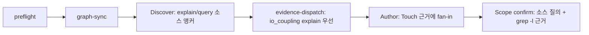

# plan 파일 추정을 원본 Graphify 질의로 전환

## Intent
- 문제: `bouncer graph-suggest`는 2026-10-15 실험(E5)에서 BP 12개, Task 34개 전부에서 후보를 내지 못했다(F1 0). 중심 함수에서 출발하는 변경이 2-hop fan-out 상한(파일 8개)에 걸리기 때문이다. 같은 BP에서 원본 `graphify explain`·`query` 질의는 소스 파일 F1 0.911이었다.
- 목표: plan은 초입에 그래프를 최신으로 맞추고, 소스 후보는 원본 Graphify 앵커 질의로, 소스 외 후보는 `grep -l`로 찾는다. `graph-suggest`의 구현·테스트·문서는 저장소에서 사라진다.

근거 자료: 저장소 루트 `graphify-query-investigation-2026-10-14.md`(Git 미추적 조사 기록).

## Success criteria
1. 활성 파일(이력인 `CHANGELOG.md`, `.bouncer/context/**`, `benchmarks/acp/fixtures/**`, 조사 기록 제외)에서 `graph-suggest`, `graphSuggest`, `graph-search`, `graphify-suggestions` 문자열 검색 결과가 0건이다.
2. `bouncer graph-suggest`는 `unknown command: graph-suggest`를 stderr에 쓰고 exit 2로 끝난다.
3. `skills/bouncer-plan/SKILL.md`에서 `bouncer graph-sync` 실행 지시가 1단계 Discover보다 앞에 있다.
4. `references/graphify-runner/index.md`는 함수 앵커 `explain`, 상수 앵커 `query --budget 1000`(`[!] TRUNCATED`일 때만 3000으로 1회 재실행), 앵커 질의를 `;`로 묶은 한 번의 Bash 호출, 자연어·짐작 심볼·줄 번호 금지, 소스 외 파일 `grep -l`과 생성본 쌍, 후보별 근거 한 줄, `graphify-out/` 경로 제거, 그래프 부재 시 `grep` 폴백을 규정한다.
5. `evidence-dispatch.md`는 `io_coupling`을 `explain` 결과로 먼저 좁힌 뒤 줄 범위만 읽게 하고, `spec-authoring`은 Touch `근거`에 호출자 수를 적을 수 있게 하되 그래프 결과로 테스트 기대값을 정하지 못하게 한다.
6. `npm run build` 뒤 `npm run ci`가 통과한다(프로젝트 병합 전 규칙).

## Out of scope
- 빌드 스탬프(`.built-from`)·미커밋 변경 검사 등 그래프 stale 방지 코드
- test 그래프와 `config.graphify.test_dirs` 축소, `graph-sync`·`graphify-bin` 동작 변경
- implementer·reviewer·debugger·finalize에서의 그래프 사용(implementer 흐름 추적은 후속 epic)
- `graphify affected` 역방향 탐색 도입(미검증, 재측정 때 비교 후보)
- `benchmarks/acp/fixtures/**` 기록 출력, `CHANGELOG.md`(릴리스 때 기록), `.bouncer/context/**` 과거 문서
- 실제 plan 10~15건 재측정
- context-search/graphify-compact-payload(graph-suggest compact payload) 문서 수정 — 이력으로 둔다

## Blueprints
* [001 graph-suggest-removal](../context-search/blueprints/graph-suggest-removal/index.md) - plan 그래프 흐름을 원본 질의로 바꾸고 graph-suggest CLI·구현·문서를 제거 (skills/bouncer-plan, references/graphify-runner, scripts/src/lib/cli*)
