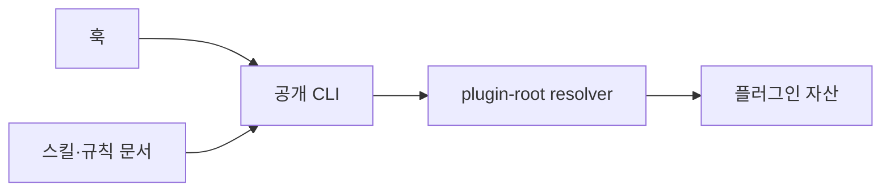

# 공개 CLI 경계와 훅·문서 이전

Epic: [host-distribution](../../index.md)

## Intent
- 훅·스킬·규칙이 `scripts/lib` 내부 모듈과 `scripts/bouncer` 경로 대신 공개 `bouncer` CLI만 호출하도록 경계를 고정한다.
- 런타임은 플러그인 자산을 검증된 plugin-root resolver로만 찾아, 다음 단계에서 런타임을 npm 패키지로 떼어내도 소비자가 깨지지 않게 한다.

## Contract
- 인터페이스:
  - `bouncer commit-guard --command-stdin [--repo <dir>]`: stdin의 셸 명령 원문을 판정한다. exit 0 허용, 1 차단(stderr에 사유), 2 사용법 오류. 기존 `--staged` 계약은 그대로다.
  - `bouncer graph-sync` JSON에 `warnings: string[]` 필드가 추가된다. 문구는 기존 SessionStart 경고와 같다.
  - `bouncer finalize worktree-path --blueprint <dir> [--repo <dir>]`: execute worktree 경로를 stdout 한 줄로 출력한다.
  - `bouncer finalize diff-sha --base <ref> [--repo <dir>]`: `{ok, sha}` 또는 `{ok:false, reason}` JSON을 출력한다.
  - 훅 런타임 탐색: `BOUNCER_BIN`(절대 경로) → PATH의 절대 경로 항목에 있는 `bouncer`(Windows는 `bouncer.cmd`). 훅은 고정 argv와 cwd로만 런타임을 부르고, 자기 플러그인 루트를 `BOUNCER_HOME`으로 넘긴다.
  - launcher 순수 명령(`commit-guard`, `current`, `project-root`, `validate`, `verify`, `graph-sync`)은 plugin root를 찾지 않고 자기 `lib/cli.js`를 실행한다.
  - 자산 읽기 resolver: `BOUNCER_HOME` → 런타임 자신의 트리(검증 통과 시) → 호스트 후보 → 실패. 후보 검증에 필수 자산(`agents/`, `skills/`, `rules/`, `references/`, `hooks/`, `AGENTS.md`) 검사가 추가된다.
- 데이터·상태: 파일 저장 형식과 문서 스키마는 바뀌지 않는다. 훅은 상태를 쓰지 않는다.
- 수용 기준:
  1. `hooks/`, `rules/`, `skills/`, `references/`, `agents/`에서 `scripts/lib` require, `node -e`, `node … scripts/bouncer` 실행이 0건이다(리뷰 예시의 fingerprint 문자열은 예외). 재발 방지 테스트가 이를 고정한다.
  2. commit 훅은 런타임 부재·실패 때 commit을 차단하고(Claude exit 2, Cursor `deny`) 복구 안내를 낸다.
  3. commit 가능성이 없는 명령(`git status`, `ls` 등)과 Bouncer 컨텍스트가 없는 저장소의 명령은 런타임을 띄우지 않고 통과한다. commit 가능성 판정은 중첩 셸·확장·쪼갠 단어·git alias를 기존 판정보다 넓게 통과시키지 않는다.
  4. Cursor 훅 stdout에는 JSON 한 객체만 나온다.
  5. SessionStart 훅은 런타임 부재·실패에도 exit 0이고 경고만 stderr에 남긴다.
  6. `codex-agents`, `print-dispatch`, `coordinate-next`는 `__dirname/../..` 대신 resolver가 준 루트에서 자산을 읽는다.
- 검증 명령: commit task별 focused `node --test`, 종단 `npm run ci`.
- 실패 모드·엣지 케이스:
  - 런타임 미설치: commit 가능성이 있는 명령은 차단, commit 가능성이 없는 명령은 영향 없음, SessionStart는 경고 후 통과.
  - 파싱할 수 없는 훅 payload는 지금처럼 통과(fail-open)한다.
  - `git -C <dir>`처럼 다른 worktree를 겨냥한 명령은 fast path를 쓰지 않는다.
  - git alias(`git ci`)는 훅이 저장소 alias 목록을 확인해 런타임 판정으로 보낸다.
  - Windows `.cmd` 실행에서 cmd.exe가 다시 파싱하는 값은 런타임 경로뿐이다. 그 경로에 셸 메타문자가 있으면 실행하지 않는다.
  - 개발 checkout에서 `BOUNCER_HOME`이 가리키는 루트가 무효여도 순수 명령은 동작한다.
  - Cursor처럼 호스트 후보가 없는 환경은 `BOUNCER_HOME` 또는 런타임 자신의 트리로 자산을 찾는다.

## Out of scope
- `packages/cli` 이동, bin 직접 실행, pack allowlist, 플러그인 release tree 축소(다음 blueprint)
- `scripts/bouncer` 존재 조건 제거, 런타임·플러그인 버전 불일치 오류, `graphify.ts`의 런타임 소유 경로(다음 blueprint)
- 버전 동기화 검사, release workflow 분기, 설치 문서 재작성(그다음 blueprint)
- `npm publish`, npm 조직·trusted publishing 설정, tag/push
- `coordinate-advance.ts` `defaultRunArgv`, `init.ts` `defaultLauncherPath`(런타임 launcher를 가리키며 플러그인 자산이 아님)
- 리뷰 예시 fingerprint 문자열(`scripts/lib/example.js` 등)과 내부 파일을 설명하는 산문 언급

## One-commit justification
- 훅·문서·런타임 resolver가 같은 공개 경계를 공유한다. 일부만 병합하면 훅은 CLI를 부르는데 CLI가 그 계약을 아직 제공하지 않는 상태가 생긴다. 그래서 한 PR로 묶고 task 단위 commit으로 나눈다.
