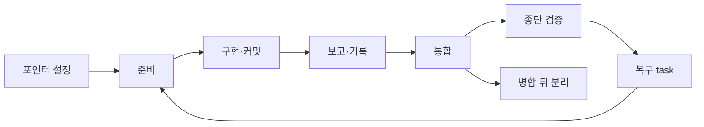

# 워크플로 상태 전이 가드 추가

Epic: [112](../../../workflow-transition-guards/index.md)

## Intent
복구 task 생성, 결과 기록, worker 재준비, 포인터 설정, 병합 뒤 실행 분리에서 잘못된 전이를 CLI가 mutation 전에 거절하고 `next`로 다음 행동을 안내하도록 함. 스킬·agent 문서도 같은 계약을 따르게 해서 순서를 에이전트의 주의력에만 맡기지 않음.

## Contract
- 인터페이스:
  - `bouncer coordinate repair ... --verify <argv> [--new-path 
]...` — `scoped_terminal`에서 `--verify` 필수.
  - `bouncer coordinate revise ... [--new-path 
]...`.
  - `bouncer current --set <bp> [--keep-others]` — `--replace`·`--clear`와 배타.
  - `bouncer run detach --blueprint <dir> --yes [--reason <text>]` — 새 하위 명령.
  - 새 거절 코드: `repair-verify-required`, `repair-verify-not-single-argv`, `repair-verify-is-terminal`, `scope-path-untracked`, `scope-new-path-parent-missing`, `worker-commit-missing`, `worker-commit-stamp-mismatch`, `worker-scope-dirty`, `worker-salvage-failed`, `CURRENT_WOULD_BE_AMBIGUOUS`, `run-detached`, `detach-worker-in-flight`, `detach-awaiting-confirmation`, `detach-confirmation-required`.
  - 모든 새 거절은 `{ ok: false, reason, cause, next }` 형식이며 exit 1이다(사용법 오류는 exit 2).
- 데이터·상태:
  - ledger `status`에 `detached`가 추가된다.
  - ledger에 `detached`, `worker-salvage` decision이 append된다. 기존 decision은 지우지 않는다.
  - salvage 산출물: integration 아래 `.bouncer/runtime/salvage/<task>-g<gen>-<short>.patch`와 ref `refs/bouncer/salvage/<task>/g<gen>-<short>`.
  - 포인터 key 파일 형식은 그대로다.
- 수용 기준: epic Success criteria 1–11.
- 검증 명령:
  - task별 `bouncer.verify`(task 전용 `node --test` argv).
  - 종단 TASKS-007의 `npm run ci`.
- 실패 모드·엣지 케이스:
  - 모든 거절은 ledger·task 문서·포인터·Git ref를 바꾸지 않는다. 테스트는 거절 전후 바이트를 비교한다. 유일한 예외는 TASKS-003의 salvage 산출물(`.bouncer/runtime/salvage/*.patch`, `refs/bouncer/salvage/*`)이다. 복구 가능한 변경을 남기는 것이 목적이므로 이후 단계가 거절돼도 지우지 않는다.
  - 다중 worker wave: 먼저 통합된 worker 때문에 `integrationHead`가 움직여도, 아직 통합되지 않은 worker의 커밋은 "커밋 없음"으로 오판되지 않는다.
  - rework·blocked 보고는 커밋 없이도 허용된다.
  - legacy task(lease generation 없음)의 salvage 이름은 `g0`을 쓴다. 같은 tip을 다시 보존하면 no-op이다.
  - nested worktree의 `current --set`은 sibling key가 있어도 막지 않는다.
  - 같은 key 갱신(`--task` 이동)은 막지 않는다.
  - finalize next-blueprint handoff가 `CURRENT_WOULD_BE_AMBIGUOUS`를 받으면 묻지 않고 보고하며 멈춘다(포인터는 비워진 채로 둔다).
  - detach는 진행 중 worker(dispatch `active|reported`, 상태 `prepared|recorded`)가 있거나 `awaiting_confirmation`이면 거절한다.
  - detach 뒤 finalize는 사용자가 포인터를 다시 설정하면 기존 경로로 가능하다.

## Out of scope
- epic Out of scope 전부.
- `commitWrite` lock-lost 시 repair 문서 rollback 누락 보완.
- drive metrics `EXCEPTION_KINDS` 변경.

## One-commit justification
- 여섯 commit task가 하나의 사전 거절 계약(거절 코드, `next` 안내, ledger 보존 규칙)을 공유한다. 리뷰어가 이 계약을 한 PR에서 함께 판정해야 문서와 CLI의 일치를 확인할 수 있다.
