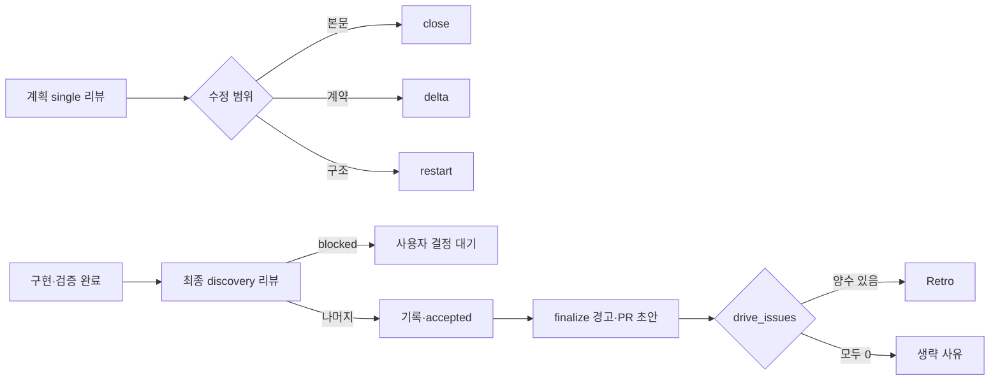

# 002 리뷰·보고·마무리 비용 축소

Epic: [107](../../index.md)

## Intent
최종 리뷰의 수정·delta 왕복과 계획 리뷰의 불필요한 재검토를 줄임. 보고·dispatch 규칙의 정본과 마무리 판단 자료를 정리해 사용자 승인과 게이트를 유지하면서 반복 입력을 줄임.

## Diagram

## Contract

### 최종 리뷰 — 결정 1·2·3·13
- `review_scope: blueprint`인 최종 리뷰만 note가 있는 `deferred must_fix`를 허용한다. G21과 blueprint-root `review.md` record가 같은 정책을 쓰며 task G14는 유지한다.
- 새 drive는 최종 discovery 리뷰 한 라운드 뒤 수정 batch와 delta를 만들지 않는다. 기존 `discovery,delta,delta` 저장본은 계속 읽힌다.
- 최종 리뷰 뒤 `repair --review-finding`과 `repair --kind supplement`는 `final-review-single-round`로 거절한다. CI 실패 `repair --failure-command`와 기존 repair wave 상한은 유지한다.
- 새 제품 결정이나 공개 인터페이스 변경을 요구하는 `blocked` finding은 accepted로 닫지 않는다. `coordinate next`는 delta 대신 `blocked`, reason `final-review-blocked`를 출력한다.
- task 없이 실행한 `review-dispatch execute --mode delta`는 사용법 오류(exit 2)다. task·light 리뷰의 delta는 유지한다.

### 레거시 전환 — 결정 4
- `bouncer migrate review-scope --blueprint <dir>`가 `review_scope: blueprint`와 root `review.md`를 명시적으로 만든다.
- `run preflight`는 review_scope 없는 레거시 blueprint를 reason `legacy-review-scope`로 막고 위 명령을 next로 안내한다. 실행 중 자동 전환은 하지 않는다.
- 기존 task 리뷰·verification과 저장된 delta 기록의 읽기 호환성을 유지한다.

### 계획 리뷰 — 결정 5
- task 수와 관계없이 최초 계획 리뷰는 `single`이다.
- `structure_parts`와 `scope_parts`가 같으면 본문 수정 후 route는 `close`다. scope 계약은 Interface·Touch·affected_paths·depends_on으로 정의한다.
- close는 현재 digest를 `closure_target_digest`로 기록하고 G18은 이 값과 비교한다. 계약 변경은 delta, 구조 변경은 restart다. 문서가 다시 바뀌면 최신성을 다시 판정한다.

### finding 정규화 — 결정 6
- execute·context 두 record 명령은 저장 전 공식 fingerprint를 계산해 입력값을 덮어쓴다.
- id 생략 시 fingerprint 해시에서 execute `F-<8hex>`, context `CR-<8hex>`를 만든다. 같은 fingerprint는 round가 달라도 같은 id를 쓰며, record 출력은 id 목록을 포함한다.
- context close도 저장본에 같은 정규화를 적용해 잘못 저장된 기존 fingerprint 때문에 닫히지 않는 문제를 해소한다.

### reviewer·implementer — 결정 7·8
- reviewer brief 문서 allowlist는 implementer의 8개 섹션 계약으로 늘린다. debugger와 공유하는 intent sections 투영 코드는 유지한다.
- 기존 기록을 위한 `nit` enum은 유지하되 reviewer는 출력하지 않는다. reviewer는 docstring 형식을 검사하지 않으며 coding-standards의 implementer 규칙은 유지한다.
- 게이트가 검사하는 항목에는 `npm run ci` 구성 명령을 나열한다.
- implementer 보고의 Open choices·Known weaknesses·Brief revision은 필수다. 빈 목록은 `- none`이며 Brief revision은 실제 attempt·task_brief_hash를 유지한다. Deviations·Scope impact·Needs planning만 값이 없을 때 생략한다.
- hand-back은 요약과 보고 경로, 값이 있을 때만 Needs planning·Scope impact를 담는다. CLI 파서의 필수 heading 계약은 유지한다.

### 문서 정본·usage — 결정 9·11
- payload·metadata·fallback·모델과 토큰 기록 규칙의 정본은 `skills/bouncer-run/references/agent-dispatch.md`다. 카드에는 단계 입력과 정본 링크만 남기고 `rule-ownership.md`에 소유 행을 추가한다.
- SHARED_RULES와 카드를 이어 붙이는 테스트는 정본 문장과 카드 링크를 각각 검사한다. SKILL.md의 `same coordinator brief` 표현도 실제 정본 참조로 바꾼다.
- 호스트 완료·usage 이벤트 대응표는 `drive-metrics.md`만 소유한다. Claude Code는 `<task-notification>`, Codex·Cursor print는 결과 JSON을 쓴다.
- usage 이벤트가 없는 호스트는 hand-back 직후 토큰 없이 `metrics end`를 호출해 missing으로 닫는다. 다른 네 곳은 대응표 링크를 사용한다.

### finalize — 결정 10·12
- prepare digest에 `drive_issues`를 PR 초안 밖의 판단 필드로 보존한다. rework 보고·debugger 호출·repair wave·fan-in 검증 실패·blocked·deferred must_fix 개수를 담는다.
- 하나라도 양수면 Retro를 실행하고 모두 0이면 `retro 생략 — 수정 문제 없음` 한 줄을 출력한다. 원장에 남지 않는 CLI 거절은 집계하지 않는다.
- blueprint 범위에서만 digest와 dry-run에 `warnings: [{ kind: 'must-fix-deferred', id, note }]`를 넣는다.
- PR 초안은 `unresolved_must_fix` 절에 같은 항목을 싣고 `review_points`에서는 제거한다. task 범위 경고 계약은 바꾸지 않는다.

### 한국어 규칙 — 결정 14
- AGENTS.md 5번: “사용자에게 보이는 모델 작성 메시지(채팅·ACQ 표시·진행·결과 보고)는 한국어로 쓴다. 코드·경로·명령·식별자·CLI 출력 원문은 그대로 둔다. 프로젝트·사용자 지시가 다르면 그 지시를 따른다.”
- `rules/acq.md`의 `plain English is fine`을 삭제하고 Recommend-why를 한국어로 쓴다. `rule-ownership.md`의 네 경계를 다섯 경계로 바꾼다.

### 수용 기준·검증
- Epic Success criteria 8–17을 충족한다. 레거시는 명시적 migrate 후 최종 리뷰에 진입하며, blocked는 deferred로 바꾸지 않는다.
- 위 성공·실패·호환성 경계를 회귀 테스트로 검증한다. 최종 fan-in은 `npm run ci`를 실행하고 게이트가 증적을 기록한다.
- TypeScript 변경은 생성본을 함께 갱신하고 agent Markdown 변경은 대응 `.codex/agents/*.toml`을 갱신한다. CHANGELOG.md Unreleased를 갱신한다.

## Out of scope
- BP 001의 이력 차단·evidence 조사·direct 실행·light 승격 구현.
- task G14의 deferred must_fix 허용, task·light 리뷰 delta 제거.
- 기존 저장 delta 시퀀스 삭제, debugger용 intent 투영 변경, implementer 필수 보고 파서 완화.
- 사용자 승인 자동화, root 직접 구현 허용, 게이트 우회, verification 증적 수기 작성.
- Explain·Quiz·comprehension 변경과 benchmark 측정.

## One-commit justification
이 blueprint는 하나의 리뷰·보고·finalize 계약을 완성하는 PR 단위다. 구현은 아래 작업별로 커밋하고 종단 검증에서 결합한다.

## Documents
* [TASKS-001](tasks/001/tasks.md) — 구현·검증 브리프
* [TASKS-002](tasks/002/tasks.md) — 구현·검증 브리프
* [TASKS-003](tasks/003/tasks.md) — 구현·검증 브리프
* [TASKS-004](tasks/004/tasks.md) — 구현·검증 브리프
* [TASKS-005](tasks/005/tasks.md) — 구현·검증 브리프
* [TASKS-006](tasks/006/tasks.md) — 구현·검증 브리프
* [TASKS-007](tasks/007/tasks.md) — 구현·검증 브리프
* [TASKS-008](tasks/008/tasks.md) — 구현·검증 브리프
* [TASKS-009](tasks/009/tasks.md) — 구현·검증 브리프
* [TASKS-010](tasks/010/tasks.md) — 구현·검증 브리프
* [TASKS-011](tasks/011/tasks.md) — 구현·검증 브리프
* [Review](review.md) — 최종 리뷰
* [Context review](context-review.md) — 계획 정합성 판정

## Scope candidates

아래 파일 목록은 사용자가 plan.affected_paths A로 확인했으며 각 task frontmatter에 반영했다. 각 task Touch 표가 파일별 변경 책임과 현재 근거를 설명한다.

Graphify source basis: `reused` — graph-sync skip-fresh. `explain(classifyExecuteReview)`, `explain(classifyPlanReview)`, `explain(prepareFinalizeDigest)`는 review-dispatch·finalize-digest 경로를 확인했다. test basis: `skip-disabled` — test_dirs 미설정으로 skip-unconfigured. `graph-suggest`는 현재 CLI가 지원하지 않아 unknown command(exit 2)였으며 ranking 제안은 없다. 나머지 후보는 rg 기반 코드·문서 조사와 생성본 쌍에서 왔다.

### TASKS-001 blueprint 최종 리뷰 단일 라운드화
- `scripts/src/lib/coordinate-next.ts` — rg 기반 조사: `scripts/src/lib/coordinate-next.ts:676`
- `scripts/src/lib/validate-sections.ts` — rg 기반 조사: `scripts/src/lib/validate-sections.ts:449`
- `scripts/src/lib/coordinator.ts` — rg 기반 조사: `scripts/src/lib/coordinator.ts:3275`
- `scripts/src/lib/review-record.ts` — rg 기반 조사: `scripts/src/lib/review-record.ts:329`
- `scripts/src/lib/cli-review-dispatch-command.ts` — rg 기반 조사: `scripts/src/lib/cli-review-dispatch-command.ts:267`
- `test/coordinate-next.test.js` — rg 기반 조사: `test/coordinate-next.test.js:476`
- `test/review-record.test.js` — rg 기반 조사: `test/review-record.test.js:209`
- `test/validate-gates.test.js` — rg 기반 조사: `test/validate-gates.test.js:2830`
- `test/coordinator.test.js` — rg 기반 조사: `test/coordinator.test.js:3218`
- `test/cli-coordinate.test.js` — rg 기반 조사: `test/cli-coordinate.test.js:705`
- `test/review-dispatch.test.js` — rg 기반 조사: `test/review-dispatch.test.js:970`
- `references/coordinator-cards/final_review.md` — rg 기반 조사: `references/coordinator-cards/final_review.md:90`
- `skills/bouncer-run/references/review-round.md` — rg 기반 조사: `skills/bouncer-run/references/review-round.md:1`

### TASKS-002 레거시 blueprint 리뷰 범위 명시적 전환
- `scripts/src/lib/migrate-review-scope.ts` — TASKS-002 Interface의 신규 migration 산출물
- `scripts/src/lib/cli-project-commands.ts` — rg 기반 조사: `scripts/src/lib/cli-project-commands.ts:314`
- `scripts/src/lib/run-preflight.ts` — rg 기반 조사: `scripts/src/lib/run-preflight.ts:357`
- `test/migrate-review-scope.test.js` — TASKS-002 Interface의 신규 migration 산출물
- `test/run-preflight.test.js` — rg 기반 조사: `test/run-preflight.test.js:36`
- `test/cli-help.test.js` — rg 기반 조사: `test/cli-help.test.js:50`
- `test/cli-project-commands.test.js` — rg 기반 조사: `test/cli-project-commands.test.js:1100`
- `docs/workflow.md` — rg 기반 조사: `docs/workflow.md:121`
- `skills/bouncer-run/SKILL.md` — rg 기반 조사: `skills/bouncer-run/SKILL.md:73`

### TASKS-003 계획 single 리뷰와 본문 수정 close 경로
- `scripts/src/lib/review-dispatch.ts` — rg 기반 조사: `scripts/src/lib/review-dispatch.ts:632`
- `scripts/src/lib/context-review-state.ts` — rg 기반 조사: `scripts/src/lib/context-review-state.ts:1365`
- `scripts/src/lib/validate-gates.ts` — rg 기반 조사: `scripts/src/lib/validate-gates.ts:1049`
- `scripts/src/lib/validate-docs.ts` — rg 기반 조사: `scripts/src/lib/validate-docs.ts:272`
- `scripts/src/lib/cli-context-review-command.ts` — rg 기반 조사: `scripts/src/lib/cli-context-review-command.ts:141`
- `test/review-dispatch.test.js` — rg 기반 조사: `test/review-dispatch.test.js:658`
- `test/context-review-state.test.js` — rg 기반 조사: `test/context-review-state.test.js:72`
- `test/validate-gates.test.js` — rg 기반 조사: `test/validate-gates.test.js:784`
- `test/validate-structural.test.js` — rg 기반 조사: `test/validate-structural.test.js:1`
- `test/skill-context-review.test.js` — rg 기반 조사: `test/skill-context-review.test.js:1`
- `skills/bouncer-plan/references/context-review.md` — rg 기반 조사: `skills/bouncer-plan/references/context-review.md:33`
- `references/context-review/index.md` — rg 기반 조사: `references/context-review/index.md:1`
- `rules/document-schema.md` — rg 기반 조사: `rules/document-schema.md:151`

### TASKS-004 finding fingerprint·id 자동 정규화
- `scripts/src/lib/validate-sections.ts` — rg 기반 조사: `scripts/src/lib/validate-sections.ts:276`
- `scripts/src/lib/review-record.ts` — rg 기반 조사: `scripts/src/lib/review-record.ts:183`
- `scripts/src/lib/context-review-state.ts` — rg 기반 조사: `scripts/src/lib/context-review-state.ts:834`
- `scripts/src/lib/cli-review-command.ts` — rg 기반 조사: `scripts/src/lib/cli-review-command.ts:220`
- `scripts/src/lib/cli-context-review-command.ts` — rg 기반 조사: `scripts/src/lib/cli-context-review-command.ts:274`
- `test/review-record.test.js` — rg 기반 조사: `test/review-record.test.js:21`
- `test/context-review-state.test.js` — rg 기반 조사: `test/context-review-state.test.js:21`
- `test/validate-gates.test.js` — rg 기반 조사: `test/validate-gates.test.js:586`
- `references/review/index.md` — rg 기반 조사: `references/review/index.md:63`
- `references/context-review/index.md` — rg 기반 조사: `references/context-review/index.md:1`

### TASKS-005 reviewer 입력과 rubric 축소
- `agents/bouncer-reviewer.md` — rg 기반 조사: `agents/bouncer-reviewer.md:37`
- `.codex/agents/bouncer-reviewer.toml` — 생성본 쌍
- `references/review/index.md` — rg 기반 조사: `references/review/index.md:52`
- `references/review/assets/reviewer-prompt.md` — rg 기반 조사: `references/review/assets/reviewer-prompt.md:35`
- `references/coordinator-cards/review.md` — rg 기반 조사: `references/coordinator-cards/review.md:53`
- `references/coordinator-cards/final_review.md` — rg 기반 조사: `references/coordinator-cards/final_review.md:53`
- `references/spec-authoring/review-rounds.md` — rg 기반 조사: `references/spec-authoring/review-rounds.md:98`
- `test/agents.test.js` — rg 기반 조사: `test/agents.test.js:130`

### TASKS-006 implementer 파일 보고와 hand-back 축소
- `agents/bouncer-implementer.md` — rg 기반 조사: `agents/bouncer-implementer.md:107`
- `.codex/agents/bouncer-implementer.toml` — 생성본 쌍
- `references/implementation/index.md` — rg 기반 조사: `references/implementation/index.md:59`
- `references/coordinator-cards/report.md` — rg 기반 조사: `references/coordinator-cards/report.md:6`
- `references/coordinator-cards/record.md` — rg 기반 조사: `references/coordinator-cards/record.md:11`
- `skills/bouncer-run/references/agent-dispatch.md` — rg 기반 조사: `skills/bouncer-run/references/agent-dispatch.md:148`
- `test/agents.test.js` — rg 기반 조사: `test/agents.test.js:130`

### TASKS-007 dispatch 공통 규칙 정본 통합
- `skills/bouncer-run/references/agent-dispatch.md` — rg 기반 조사: `skills/bouncer-run/references/agent-dispatch.md:4`
- `skills/bouncer-run/references/verification-recovery.md` — rg 기반 조사: `skills/bouncer-run/references/verification-recovery.md:4`
- `references/coordinator-cards/dispatch.md` — rg 기반 조사: `references/coordinator-cards/dispatch.md:6`
- `references/coordinator-cards/implement.md` — rg 기반 조사: `references/coordinator-cards/implement.md:38`
- `references/coordinator-cards/review.md` — rg 기반 조사: `references/coordinator-cards/review.md:12`
- `references/coordinator-cards/final_review.md` — rg 기반 조사: `references/coordinator-cards/final_review.md:11`
- `references/coordinator-cards/verify.md` — rg 기반 조사: `references/coordinator-cards/verify.md:15`
- `references/coordinator-cards/report.md` — rg 기반 조사: `references/coordinator-cards/report.md:6`
- `references/coordinator-cards/record.md` — rg 기반 조사: `references/coordinator-cards/record.md:14`
- `rules/subagent-model.md` — rg 기반 조사: `rules/subagent-model.md:30`
- `agents/bouncer-coordinator.md` — rg 기반 조사: `agents/bouncer-coordinator.md:139`
- `.codex/agents/bouncer-coordinator.toml` — 생성본 쌍
- `skills/bouncer-run/SKILL.md` — rg 기반 조사: `skills/bouncer-run/SKILL.md:118`
- `docs/architecture/rule-ownership.md` — rg 기반 조사: `docs/architecture/rule-ownership.md:39`
- `test/coordinate-next.test.js` — rg 기반 조사: `test/coordinate-next.test.js:1294`
- `test/coordinator.test.js` — rg 기반 조사: `test/coordinator.test.js:1723`
- `test/subagents.test.js` — rg 기반 조사: `test/subagents.test.js:566`
- `test/doc-shape-cli.test.js` — rg 기반 조사: `test/doc-shape-cli.test.js:192`
- `test/skill-bouncer-surface.test.js` — rg 기반 조사: `test/skill-bouncer-surface.test.js:406`
- `test/skill-bouncer-run.test.js` — rg 기반 조사: `test/skill-bouncer-run.test.js:44`

### TASKS-008 finalize 미해결 경고와 Retro 판단 digest
- `scripts/src/lib/finalize-digest.ts` — rg 기반 조사: `scripts/src/lib/finalize-digest.ts:616`
- `scripts/src/lib/finalize-pr.ts` — rg 기반 조사: `scripts/src/lib/finalize-pr.ts:223`
- `scripts/src/lib/finalize.ts` — rg 기반 조사: `scripts/src/lib/finalize.ts:1129`
- `test/finalize-digest.test.js` — rg 기반 조사: `test/finalize-digest.test.js:286`
- `test/finalize-pr.test.js` — rg 기반 조사: `test/finalize-pr.test.js:626`
- `test/finalize.test.js` — rg 기반 조사: `test/finalize.test.js:1`
- `test/finalize-pure.test.js` — rg 기반 조사: `test/finalize-pure.test.js:1083`
- `test/skill-bouncer-finalize.test.js` — rg 기반 조사: `test/skill-bouncer-finalize.test.js:26`
- `skills/bouncer-finalize/SKILL.md` — rg 기반 조사: `skills/bouncer-finalize/SKILL.md:100`
- `skills/bouncer-finalize/references/draft-pr.md` — rg 기반 조사: `skills/bouncer-finalize/references/draft-pr.md:41`

### TASKS-009 호스트별 usage 완료 규칙 단일화
- `skills/bouncer-run/references/drive-metrics.md` — rg 기반 조사: `skills/bouncer-run/references/drive-metrics.md:26`
- `skills/bouncer-run/SKILL.md` — rg 기반 조사: `skills/bouncer-run/SKILL.md:142`
- `rules/subagent-model.md` — rg 기반 조사: `rules/subagent-model.md:53`
- `agents/bouncer-coordinator.md` — rg 기반 조사: `agents/bouncer-coordinator.md:140`
- `.codex/agents/bouncer-coordinator.toml` — 생성본 쌍
- `rules/cursor-print-dispatch.md` — rg 기반 조사: `rules/cursor-print-dispatch.md:47`
- `skills/bouncer-run/references/agent-dispatch.md` — rg 기반 조사: `skills/bouncer-run/references/agent-dispatch.md:1`
- `test/skill-bouncer-run.test.js` — rg 기반 조사: `test/skill-bouncer-run.test.js:55`
- `test/subagents.test.js` — rg 기반 조사: `test/subagents.test.js:638`
- `test/agents.test.js` — rg 기반 조사: `test/agents.test.js:130`

### TASKS-010 사용자 대상 한국어 하드룰과 변경 기록
- `AGENTS.md` — rg 기반 조사: `AGENTS.md:18`
- `rules/acq.md` — rg 기반 조사: `rules/acq.md:40`
- `docs/architecture/rule-ownership.md` — rg 기반 조사: `docs/architecture/rule-ownership.md:11`
- `CHANGELOG.md` — rg 기반 조사: `CHANGELOG.md:8`
- `test/master-rules.test.js` — rg 기반 조사: `test/master-rules.test.js:428`
- `test/acq-gate-ids.test.js` — rg 기반 조사: `test/acq-gate-ids.test.js:120`

TASKS-011은 source 변경 없는 verification node로 affected_paths: []를 유지한다.
