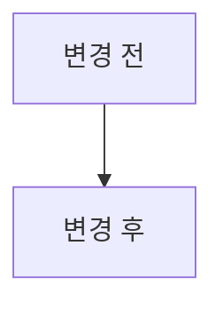

## 관련 이슈

- Explain: [explain.md](<head에서 열리는 URL>)

<!--
Bouncer 사이클이 아니면 Explain 줄을 지운다.
이슈 근거가 없으면 이슈 불릿을 만들지 않는다.
-->

## 배경 · 변경 의도

- 문제
  - 문제 내용
  - 문제 내용
- 의도
  - 의도 내용
  - 의도 내용

## 주요 변경 내용

| 파일 | 변경 |
| --- | --- |
|  |  |

## 변경 그림

<!--
필수. 변경 성격에 맞는 그림을 Mermaid로 그린다(로직·제어 흐름 → 흐름도·상태 전이도,
구조·책임·호출 → 구성도·호출 관계도, 동작·출력 → 변경 전후 비교,
문서·설정·테스트 → 대상과 영향 관계 도식). 노드는 2개 이상 8개 안팎이며
diff·Explain에 없는 노드는 넣지 않는다. 그림 옆에 핵심 설명 한두 줄을 쓴다.
-->

## 변경 전후

<!--
필수. 출처는 확인 방법의 검증 결과, Explain, diff뿐이다.
변경 전 관측이 없으면 `변경 전 결과 미관측`이라고 쓴다.
-->

| 항목 | 변경 전 | 변경 후 |
| --- | --- | --- |
|  |  |  |

## 리뷰 포인트

-

## 되돌리기 · 영향 범위

<!--
필수. 되돌리는 방법과 복구 범위, 커밋 되돌리기로 복구되지 않는 데이터·외부 동작·계약 영향,
잘못 적용했을 때 영향을 받는 기능·소비자·데이터를 쓴다.
위험 분류는 승인이나 자동 병합 근거가 아니다.
-->

-

## 확인 방법

-
